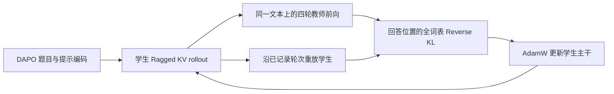

# 项目目录与实现逻辑

Exploration-Preserving-Loop 以 Ouro 循环语言模型为主。Phase 0 用原始权重测固定轮数、原生 Ouro KV 和 Ragged KV。RAD-OPD 在学生自己生成的文本上，用冻结的四轮教师监督学生实际使用的读出轮次。实验定义、当前参数和已完成结果见已有方案。 [项目约定](../AGENTS.md) · [RAD-OPD 方案](rad_opd_mvp.md) · [Phase 0 结果](ragged_kv_reproduction.md)

## 1. 目录结构

```text
Exploration-Preserving-Loop/
├── AGENTS.md                         项目约定、实验组定义和结果口径
├── README.md                         环境、资产准备和启动入口
├── requirements-*.txt                各 Python 环境的依赖清单
├── pytest.ini                         测试入口配置
├── configs/                          模型、数据、训练、评测和消融配置
│   ├── default.json                  默认指向 rad_opd.json
│   ├── rad_opd.json                  RAD-OPD 主配置
│   ├── rad_opd_pilot.json            当前本机试跑配置
│   ├── paper_ouro_base.json          Ouro 模型及通用训练参数
│   └── …                             其他模型、执行路线和对照组
├── ep_loop/                          Python 实现
│   ├── ouro.py / huginn.py           原模型接口与循环前向
│   ├── inference.py / ragged.py      生成、Ragged KV、可微重放
│   ├── training.py / objective.py    训练循环和蒸馏目标
│   ├── selection.py / cache.py       读出选择、阶段目标和缓存组件
│   └── fastpath/                     vLLM、vLLM-RLT 与可选加速训练
│       └── vendor/                   上游模型参考源码及来源清单
├── scripts/                          数据准备、训练、评测、测速和核验入口
├── tests/                            语义、路由、评测和续跑测试
├── docs/                             方案、环境、复现和测速说明
├── data/                             本机已处理的数据
│   ├── bbh_frontier/                 冻结的 BBH 135 题及清单
│   └── DAPO-Math-17k/                本机试跑用的原始 DAPO Parquet
├── models/                           模型资产入口，本机用软链接
├── external/                         固定版本的 vLLM-RLT 与 verl 源码
├── .venv/                            PyTorch/HF、vLLM-RLT、verl 环境
├── ep_loop_envs/vllm026/              官方 vLLM 0.26 环境
├── ep_loop_runs/                     本机逐次运行的日志、结果和检查点
├── .cache/                           上游数据、安装记录和依赖缓存
├── audit/                            历史测速、评测核验和源码快照
├── experiments/                      历史实验矩阵和运行索引
├── papers/                           核心论文 PDF、源码与版本清单
└── ref/                              相关论文、证据索引和版本清单
```

模型权重、下载后的数据、外部源码、虚拟环境和本机运行结果按 `.gitignore` 从常规版本跟踪中排除。`models/.gitkeep` 保留模型入口。`audit/` 有可核对的历史记录，也容纳本机固定版本的 RLT 源码。查看某次实验的实际参数时，以该次的 `plan.json` 或 `resolved_config.json` 和对应引擎日志为准。 [.gitignore](../.gitignore) · [实验矩阵](../experiments/formal_experiment_matrix.csv) · [论文清单](../papers/manifest.json) · [参考索引](../ref/README.md)

## 2. 环境、模型与数据

本机路径、资产检查和运行产物以 2026-11-27 的工作目录为准。

### 2.1 Python 环境

| 路径 | 本机主要组件 | 运行路径 |
| --- | --- | --- |
| `.venv/bin/python` | Python 3.10、PyTorch `2.8.0+cu128`、Transformers `4.57.1`、Triton `3.4.0`、vLLM-RLT `0.2.0` 和 verl `v0.8.0` | 训练、评测主进程、PyTorch 模型以及 vLLM-RLT 子进程 |
| `ep_loop_envs/vllm026/bin/python` | Python 3.12、vLLM `0.26.0+cu129`、PyTorch `2.11.0+cu129`、FlashInfer `0.6.14` | 官方 vLLM 固定轮数和原生 Ouro KV 的子进程 |

评测主进程用 token IDs、采样参数和请求编号与推理子进程通信。两个解释器加载各自的 PyTorch/CUDA 依赖。vLLM-RLT 的 `benchmark-venv` 是指向 `.venv` 的兼容链接。当前 RAD-OPD 训练由仓库里的 PyTorch 训练器驱动，verl 安装在同一环境中，已有单独的依赖和 FSDP 验证记录。Phase 0 在本机存在 CUDA 12.8 工具链时会为引擎选用它，FlashInfer 可用它编译内核。 [本机环境与重建命令](core_environment.md) · [依赖入口](../requirements-core.txt) · [Phase 0 入口](../scripts/evaluate_stage_distillation.py)

### 2.2 模型资产

| 模型 | 用途 | 本机路径 |
| --- | --- | --- |
| 原始 `Ouro-1.4B-Thinking`，revision `3aaa222` | AIME Phase 0、RAD-OPD 的教师和学生初始权重 | `models/Ouro-1.4B-Thinking` → `../../huggingface_models/Ouro-1.4B-Thinking` |
| 原始非 Thinking `Ouro-1.4B`，revision `574fa66` | BBH 首批复现 | `../huggingface_models/Ouro-1.4B`，冻结计划记录其路径 |
| `Ouro-2.6B`，revision `1ed0425` | BBH 脚本支持的另一组原始权重 | 由 `plan --model-dir` 指定 |
| `Huginn` | 备用阶段蒸馏路线与部分测试 | 对应配置要求独立模型目录及官方模型源码 |

`backends.load_backend()` 按 `model.family` 选 Ouro 或 Huginn。Ouro 路径通过 `ouro.author_module()` 载入模型目录自带的配置和模型代码。训练资产检查读取模型 revision 元数据、源码、权重分片和训练 JSONL 行数。BBH 的冻结计划还会记录模型和 tokenizer 文件的 SHA-256。 [后端分发](../ep_loop/backends.py) · [Ouro 加载](../ep_loop/ouro.py) · [模型配置](../configs/paper_ouro_base.json) · [BBH 计划](../scripts/reproduce_ragged_bbh.py)

### 2.3 数据资产

| 数据 | 数量与用途 | 当前路径或配置 |
| --- | --- | --- |
| BBH frontier | 27 个子任务各 5 题，共 135 题，供非 Thinking 模型 Phase 0 评测 | [eval.jsonl](../data/bbh_frontier/eval.jsonl) · [manifest.json](../data/bbh_frontier/manifest.json) |
| AIME 2024 | 30 题，供 Thinking 模型 Phase 0 和 checkpoint 评测 | [首批运行使用的 aime2024.jsonl](../ep_loop_runs/aime2024_phase0_20261125_FI3s1w/aime/aime2024.jsonl) · [冻结清单](../ep_loop_runs/aime2024_phase0_20261125_FI3s1w/aime/manifest.json) |
| RAD-OPD 主配置的 DAPO 训练池 | 配置预期 17,309 条 | `data/dapo_ablation/ouro_seed42_trainall_dev64_eval64_prompt1024_aime30_clean/train.jsonl`，本机资产检查当前缺这一文件。[主配置](../configs/rad_opd.json) |
| RAD-OPD 本机试跑训练池 | 1,791,700 行，保留源文件中的重复记录 | [原始 Parquet](../data/DAPO-Math-17k/data/dapo-math-17k.parquet) · [试跑配置](../configs/rad_opd_pilot.json) |

本机试跑按 Parquet 的原始行顺序加载，用行号标识样本。重复行分别参与采样，相同提示的 token 编码可复用。训练记录可用题池和顺序的哈希供续跑核对。历史 JSONL 训练池可用 `prepare_stage_data.py` 从本地数据准备。 [记录与提示编码](../ep_loop/data.py) · [历史数据准备](../scripts/prepare_stage_data.py)

`prepare_aime_data.py` 负责冻结 AIME 2024、2025、2026 的公开来源，可按年份准备。每年校验 30 题及 `0–999` 的整数答案。提示由题面和要求用 `\boxed{}` 给出最终答案的指令构成。脚本默认写入 `data/aime/`，已有 AIME 2024 运行直接使用上表所列的冻结文件。 [AIME 数据准备](../scripts/prepare_aime_data.py) · [评测数据校验](../ep_loop/evaluation_data.py)

### 2.4 配置如何生效

`config.load_config()` 循环解析相对于子配置所在目录的 `extends`。字典按键递归合并，标量和列表由子配置替换。主链是 `default.json → rad_opd.json → paper_ouro_base.json`，试跑配置在 `rad_opd.json` 上覆盖一组参数。`execution_mode` 决定训练和兼容的评测入口。`validate_config()` 检查模型、数据、批量大小、退出策略、教师和 loss 组合。 [配置解析](../ep_loop/config.py) · [执行模式检查](../ep_loop/execution.py)

| 参数 | 主配置生效值 | 本机试跑 |
| --- | --- | --- |
| 教师和学生 | Ouro-1.4B-Thinking，教师固定 4 轮，学生最多 4 轮 | 同主配置 |
| 执行模式 | `hf_rad_opd`，rollout 和教师均用 HF/PyTorch | vLLM-RLT 学生生成、官方 vLLM 0.26 教师前向、PyTorch 重放和反传 |
| 每步训练题数与 rollout 数 | 32 题，每题 8 条，共 256 条 | 4 题，每题 4 条，共 16 条 |
| 训练步数、学习率 | 100 次更新，AdamW，`1e-6` | 16 次更新，学习率继承 |
| 权重与续跑状态 | 每 20 次更新保存检查点 | 第 4、8、12、16 步保存权重。每步更新 `resume/latest`，保留最新可续跑状态 |
| 单条训练回答的生成上限 | 16,384 个新 token | 16,384 个新 token |
| rollout 采样 | 温度 1.0，top-p 1.0 | 温度 1.0，top-p 1.0。每题 4 条依次使用种子 `42 / 43 / 44 / 45` |
| 训练阈值 | 80% 从 `[0.15, 0.40]` 均匀抽样，其余从 `{0.60, 1.00}` 选取 | 前七次更新依次用 `0.8 / 0.6 / 0.4 / 0.3 / 0.25 / 0.2 / 0.15`，随后使用混合分布 |
| AIME 阈值和预算 | `0.15 / 0.20 / 0.25 / 0.30 / 0.45 / 0.75`，2K／4K／8K／16K 切片 | 阈值 `0.20 / 0.45`，评测预算继承 |

参数来源见 [基础配置](../configs/paper_ouro_base.json) · [主配置](../configs/rad_opd.json) · [当前试跑配置](../configs/rad_opd_pilot.json) · [已停止的首轮试跑配置快照](../ep_loop_runs/rad_opd_pilot_cS16xeF4/resolved_config.json)

试跑教师使用初始权重。逐步刷新教师时，两个推理引擎读取同一步保存的学生权重，教师目标停止梯度。[逐步刷新教师的配置](../configs/rad_opd_pilot_current_teacher.json) · [训练实现](../ep_loop/training.py)

## 3. Ouro 循环、读出轮次与 KV

一次循环让当前位置的状态通过同一套 Ouro 主干层，再把归一化后的状态交给下一轮。第 `r` 轮的 attention 读写第 `r` 轮的 KV，读出时把选中的状态送入 LM head 得到 token logits。原生退出门的输出先过 sigmoid。设 `q_r` 为已经执行到第 `r` 轮时退出的条件概率，则在第 `r` 轮退出的概率为 `q_r × ∏(1 − q_i)`，乘积覆盖所有更浅轮，最后一轮取得剩余概率。读出轮次取累计概率首次达到 `τ` 的轮。 [CDF 实现](../ep_loop/selection.py) · [Ouro 前向](../ep_loop/ouro.py) · [vLLM 读出选择](../ep_loop/fastpath/readout.py)

| 方式 | Prefill 与首个 token | Decode | 历史 KV |
| --- | --- | --- | --- |
| **Dense 4-Loop** | 整段提示跑 4 轮，首个 token 用第 4 轮 | 每步执行 4 轮并从第 4 轮采样 | 读取历史 token 各轮自己计算的 KV |
| **Static 2-Loop / 1-Loop** | 整段提示固定 2／1 轮 | 每步在所选固定轮数采样 | 保存所选轮数内每轮自己的 KV |
| **原生 Ouro KV** | 整段提示跑 4 轮，评测规定首个 token 用第 4 轮 | 官方 vLLM 每步执行 4 轮，退出门决定从哪一轮采样 | 四轮各有自己的 KV |
| **Ragged KV** | 整段提示跑 4 轮，首个 token 用第 4 轮 | vLLM-RLT `LAST_EXITED` 逐轮判定，达到阈值就采样 | 深轮读取该历史位置最后实际执行轮次的 KV |

例如，输入位置 `x` 在第 2 轮给出了采样分布，采得 `y`。原生 Ouro KV 已计算 `x` 的四轮 KV，下一步输入 `y` 时，第 3 轮 attention 读取 `x` 的第 3 轮 KV。Ragged KV 在第 2 轮结束 `x` 的计算，处理 `y` 若走到第 3 轮，attention 读取 `x` 的第 2 轮 KV。 [Ragged KV 方案](rad_opd_mvp.md) · [本机组别约定](../AGENTS.md) · [Ragged KV 实现](../ep_loop/ragged.py)

`exit_depths[i]` 记录预测第 `i+1` 个回答 token 时使用的读出轮次。数组第一项来自 prompt 最后的预测位置。之后的每一项来自对前一个回答 token 的前向。`execution_depths` 与它逐步对齐，表示对应前向实际执行的轮数。对提示长度 `P`、回答长度 `T`，实际消费的位置是 `P + T − 1`，即整段提示和前 `T−1` 个回答 token。四轮路径的有效 `token-loop` 是 `4 × (P + T − 1)`。Ragged KV 的计数是 `4 × P + sum(execution_depths[1:])`。例如 `P=3`、`T=4`、Ragged 轨迹 `[4, 2, 4, 1]` 对应 `3 × 4 + 2 + 4 + 1 = 19` 个 token-loop，四轮路径对应 24 个。 [生成循环](../ep_loop/inference.py) · [RLT 计数](../ep_loop/fastpath/rlt_server.py) · [AIME 汇总](../scripts/evaluate_stage_distillation.py)

## 4. 评测与训练中的 KV 实现

### 4.1 官方 vLLM 的固定轮数与原生 Ouro KV

1. 入口用 `VllmActor` 按指定解释器启动 `vllm_server.py`，设置可见 GPU，并在 stdout 上收发 JSON Lines。stderr 写到对应引擎日志。固定轮数使用 vLLM 内置的 `OuroForCausalLM`，通过配置覆盖设置循环次数。 [进程封装](../ep_loop/fastpath/actor.py) · [vLLM 服务](../ep_loop/fastpath/vllm_server.py)
2. `policy=native` 走 V2 Model Runner，加载仓库注册的 `EPLoopOuroForCausalLM`。适配模型逐轮执行 attention，每轮使用独立的 attention/KV 层编号。模型保留门控选择的状态、第四轮状态及读出诊断。 [vLLM Ouro 适配](../ep_loop/fastpath/vllm_ouro_v026.py) · [读出函数](../ep_loop/fastpath/readout.py)
3. `OuroWorkerExtension` 对每条采样行计算 `positions[logits_indices] - prompt_len + 1`。返回 `0` 的行预测首个回答 token，送第四轮状态进入 LM head。之后的 decode 行用 CDF 选中的状态。该判断按请求执行，同批可以同时包含一条新请求的 prefill 和另一条请求的 decode。这里用原始 `prompt_len`，这样调度恢复后即使 prefill 还覆盖已经生成的文本，也能认出真正的首个回答位置。 [工作进程扩展](../ep_loop/fastpath/vllm_worker.py)
4. vLLM 自己完成采样、请求调度和后续 KV 读写。服务按请求 ID 和输出位置对齐读出诊断，略过未采纳的分块 prefill 采样。返回的 `exit_depths` 可以在 1–4 之间变化，`execution_depths` 对这组全是 4。原生 Ouro KV 的每个阈值用独立引擎配置加载，并有自己的日志文件。 [请求对齐](../ep_loop/fastpath/actor.py) · [返回协议](../ep_loop/fastpath/vllm_server.py) · [AIME 路由](../scripts/evaluate_stage_distillation.py)

### 4.2 vLLM-RLT 的 Ragged KV

`RltActor.from_release()` 校验 vLLM-RLT `v0.2.0`、提交 `c08b9d7`、本地已跟踪文件状态和实际导入路径。它启动 `rlt_server.py`，由 `StageEngine` 执行批量调度。BBH 和 AIME 动态组传入 `min_loops=1`、`max_loops=4` 和各请求的 `exit_threshold`，prefill 用模型配置中的 4 轮。每条请求完成时返回其 token IDs、退出轮次、结束原因和耗时。 [RLT 进程封装](../ep_loop/fastpath/rlt_actor.py) · [RLT 服务](../ep_loop/fastpath/rlt_server.py)

`LAST_EXITED` 在 decode 跳过早退位置的后续循环，用最后执行轮的 KV 值填充深轮缓存页。计算量按早退的实际轮数统计。物理页按 vLLM-RLT 实际分配统计。 [RLT v0.2.0 的 KV 复制](https://github.com/InferMatrixLab/vllm-rlt/blob/c08b9d79834bb8b4ff283b15bae2c14c559f6b52/vllm_rlt/core/kv_cache_manager.py#L751-L777) · [本机复现口径](ragged_kv_reproduction.md)

Phase 0 的 RLT 使用 Triton、同步 CUDA Graph、KV block 64、prefill chunk 128 和最大批处理 token 数 4,096。两套评测引擎使用 BF16、显存比例 `0.90`、各自默认 `max_num_seqs`，应用入口每批最多提交 8 个请求。RLT 生效默认值为 8。Phase 0 关闭前缀缓存和投机解码。`configs/evaluation_vllm_rlt.json` 是另一条固定轮数评测配置，有自己的前缀缓存设置。 [BBH 冻结选项](../scripts/reproduce_ragged_bbh.py) · [AIME 引擎选项](../scripts/evaluate_stage_distillation.py) · [固定轮数 RLT 配置](../configs/evaluation_vllm_rlt.json)

### 4.3 PyTorch 的 Ragged KV 训练实现

`inference.generate()` 在评估模式和 `no_grad` 下逐步调用 `OuroBackend.trace()`。Ragged 策略进入 `rollout_trace()`，prefill 执行到最大轮数，decode 单步只消费一个输入 token。每一轮调用 Ouro 的各层，随后检查退出门。`τ=1.0` 的 Ragged 路线执行到最大轮数。当前实现要求单条无 padding 输入、全因果 attention 与零 attention dropout。 [生成函数](../ep_loop/inference.py) · [Ouro 策略分发](../ep_loop/ouro.py) · [Ragged rollout](../ep_loop/ragged.py)

`RaggedKVCache` 为每个主干层保有 K/V 缓冲区。每执行一轮，只对当前输入位置追加实际产生的槽。`indices[r]` 映射可见历史位置到第 `r` 轮应读的物理槽。`finish()` 为未执行的深轮写入最后一轮的槽号。下一步 attention 用 `index_select` 取出本轮可见的 KV 后交给 SDPA。`physical_kv_token_slots` 统计每层已写入的有效槽位，容量余量、索引张量和临时 gather 另有实际显存成本。 [缓存与索引实现](../ep_loop/ragged.py) · [缓冲区](../ep_loop/cache.py) · [模型加载与 SDPA](../ep_loop/ouro.py)

## 5. Phase 0 评测如何运行

### 5.1 BBH

1. `prepare_ragged_bbh.py` 从固定版本的 `lukaemon/bbh` test 和 BIG-Bench-Hard CoT 提示准备数据。每个子任务以种子 1234 独立抽 5 题，构造 3-shot 纯文本提示，并写入源文件、抽样索引、提示和数据哈希。 [数据准备](../scripts/prepare_ragged_bbh.py)
2. `reproduce_ragged_bbh.py plan` 校验模型和数据，冻结 `plan.json`。首批 `core` 包含固定 2／4 轮和 `τ=0.10 / 0.15 / 0.20 / 0.25 / 0.30`，共 7 组。`full` 另含固定 1／3 轮，共 9 组。每组 135 题，每题 4 条，温度 1.0、top-p 0.7、关闭 top-k，EOS 或 1,024 新 token 停止。 [运行脚本](../scripts/reproduce_ragged_bbh.py) · [已运行计划](../ep_loop_runs/ragged_bbh_rlt_1p4b/plan.json)
3. `run` 根据题在数据中的位置给分片分配任务。以 `(实验组, 题号, 样本号)` 为 SQLite 主键，每条完成即提交，重启同分片时按主键跳过已有结果。各组用生成根种子 42、提示哈希和样本号派生每条请求的种子。 [运行脚本](../scripts/reproduce_ragged_bbh.py) · [首批分片库](../ep_loop_runs/ragged_bbh_rlt_1p4b/shard_00.sqlite)
4. `summarize` 检查每个分片匹配计划哈希、覆盖所有预期样本，再计算 Pass、深度、长度及截断率。组间差值按同题配对并按 BBH 子任务分层做 bootstrap。原评分取生成文本最后一处 `the answer is …`，首批复判先在首个新 `\nQ:` 处截断，再对当前题答案做同样的精确匹配。耗时与轮数仍按完整输出统计。 [评分与汇总](../scripts/reproduce_ragged_bbh.py) · [原汇总](../ep_loop_runs/ragged_bbh_rlt_1p4b/summary_core.json) · [复判表](ragged_kv_reproduction.md#首批结果与论文对照)

首批已有 `7 × 135 × 4 = 3,780` 条。两套引擎分别使用各自的随机数实现，同一题和样本的配对以数据、采样配置和种子为口径，随机 token 轨迹可能不同。 [首批对照及论文口径](ragged_kv_reproduction.md)

### 5.2 AIME 2024

同一入口 `evaluate_stage_distillation.py` 通过参数选择模型与后端。AIME 2024 使用 30 题、每题 4 条，温度 1.0、top-p 0.7、关闭 top-k，从根种子 42 派生采样种子。生成遇 EOS 或达到 16,384 新 token 停止。引擎最大序列长度取提示上限 1,024 与生成上限之和，即 17,408。使用 Thinking chat template，并从同一条回答截取 2,048／4,096／8,192／16,384 token 评分。答案从最后一个完整的 `\boxed{}` 提取并按整数精确匹配。 [AIME 入口](../scripts/evaluate_stage_distillation.py) · [整数判分](../ep_loop/inference.py) · [实验说明](ragged_kv_reproduction.md)

| 参数 | 原始权重或 checkpoint | 执行方式 |
| --- | --- | --- |
| `--phase-zero` | 配置指定的原始 Ouro-1.4B-Thinking | 官方 vLLM 固定 1／2／4 轮、vLLM-RLT 的 Ragged KV 六个阈值、官方 vLLM 的原生 Ouro KV 六个阈值，共 15 组 |
| `--phase-zero --skip-native` | 原始权重 | 固定轮数和 Ragged KV 共 9 组 |
| `--checkpoint` | 已保存的 RAD-OPD 学生 | PyTorch 执行 Ragged KV，按指定阈值测准确率、计算量和有效物理槽 |
| `--checkpoint --vllm-rlt` | 已保存的 RAD-OPD 学生 | vLLM-RLT `LAST_EXITED` 执行 Ragged KV，加载时兼容 HF 保存的策略元数据 |
| `--checkpoint --loops N` | 已保存的学生或显式指定的原始权重目录 | 走该入口的固定轮数 HF 对照，`--loops` 可重复传入 |

逐条结果和汇总用 `experiment_group` 记录组名，后端、实际执行深度、读出深度和物理 KV 槽各有单独的字段。逐条结果也记录题号、样本号、数据指纹、种子、token-loop、结束状态和各预算判分。`--write-token-ids` 保存 token IDs。加速评测的 `--resume` 校验组别、后端、题目和样本标识、预算切片与序列长度，从已保存的 token IDs 恢复汇总并生成缺失样本。同一输出文件由锁保护。已有 AIME Phase 0 文件包含 9 组、1,080 条，原生 Ouro KV 六组共 720 条待补。 [评测与续跑实现](../scripts/evaluate_stage_distillation.py) · [已有逐条结果](../ep_loop_runs/aime2024_phase0_vllm_Ah7meM4r/responses.jsonl) · [已有汇总](../ep_loop_runs/aime2024_phase0_vllm_Ah7meM4r/responses.summary.json)

## 6. RAD-OPD 训练实现



### 6.1 初始化、抽题与生成

1. `scripts/train_stage_distillation.py` 载入配置。`hf_rad_opd` 进入 `ep_loop/training.py`，先检查模型、数据行数和 revision，再载入官方模型与 tokenizer。学生与教师从同一份原始权重初始化。教师处于 eval 且全参数冻结，学生的 Ouro 原生退出门由 `DistillationObjective` 冻结。主配置使用 FP32 参数、CUDA BF16 前向及梯度检查点。 [训练入口](../scripts/train_stage_distillation.py) · [训练循环](../ep_loop/training.py) · [Loss 初始化](../ep_loop/objective.py)
2. 每次更新从训练池内无放回抽题，各更新独立抽样。DDP 时各 rank 按同一个抽样列表分配不同题目。`sample_training_threshold()` 先检查按更新指定的初始阈值，再检查固定阈值选项，最后按根种子、题目哈希和更新索引抽混合分布。同一题在本次更新中的所有回答使用同一 `τ`。 [抽题与编码](../ep_loop/data.py) · [训练阈值](../ep_loop/ragged.py) · [样本种子](../ep_loop/reproducibility.py)
3. 学生按 Ragged KV rollout 生成回答。每条保存 token IDs、读出轮次、`τ`、EOS 状态、实际 token-loop 和物理槽位。主配置对完整和截断的回答都训练。若配置了 `data.rad_offline_responses`，则按 `(problem_sha256, sample)` 读取给定的教师回答 token，并沿这些 token 重新计算学生的退出轨迹。 [训练与逐条记录](../ep_loop/training.py) · [离线数据索引](../ep_loop/data.py) · [生成](../ep_loop/inference.py)

### 6.2 教师评分与学生可微重放

教师读取学生的提示和已生成文本做 teacher-forced 前向。设提示长度为 `P`，回复为 `y1 … yT`，前向输入是 `[prompt, y1, …, y(T−1)]`。从位置 `P−1` 开始提取恰好 `T` 个预测位置，用教师第 4 轮分布评分。教师走独立的完整四轮计算，学生维持自己的 KV 和权重。 [预测位置对齐](../ep_loop/objective.py) · [Ouro 批量读出](../ep_loop/ouro.py)

学生的 `replay_trace()` 使用 rollout 记录的每个位置的轮次。对于第 `r` 轮，它构造 `live = (rollout_depth >= r)`，并通过 `ReplayRoundKV` 应用 `torch.where(live, current, previous)`。执行到该轮的位置用当前投影的 KV，其余位置沿用上一轮有效 KV。重放对整段输入执行四轮，读出取回每个预测位置实际使用过的那一轮。训练重放单独统计这部分前向计算量。 [重放函数](../ep_loop/ragged.py) · [训练目标](../ep_loop/objective.py)

默认 No-Detach 保留从深轮注意力经过复用 KV 回到早退位置的梯度。设置 `algorithm.rad_detach_reused_kv=true` 可在复用分支对历史 KV 做 `detach()`，用于消融。两个设置都沿用 rollout 时记录的退出轮次。 [可微 KV 选择](../ep_loop/ragged.py) · [梯度测试](../tests/test_rad_opd.py)

### 6.3 Loss、更新与保存

学生在每个实际读出位置得到 `log p_student`，教师提供满深度 `log p_teacher`。端点蒸馏使用全词表 Reverse KL，分块算 `sum_v p_student(v) × (log p_student(v) − log p_teacher(v))`。先按回答 token 平均，再按当前更新的回答数聚合。主配置的阶段选择为 `endpoint`，退出门 loss 权重为 0。梯度在多个回答的 microbatch 之间累积，最后执行 AdamW 更新。 [KL 实现](../ep_loop/objective.py) · [训练更新](../ep_loop/training.py) · [主配置](../configs/rad_opd.json)

每个可续跑 checkpoint 包含学生权重、模型/分词器文件、`run_config.json`、`training_state.pt`、各 rank 的 `rng_rank<N>.pt` 和完成标记 `checkpoint.complete.json`。续跑校验保存配置、world size、优化器和题池指纹，并恢复数据抽样与 rollout RNG。冻结教师从初始权重建立，随后才把 checkpoint 权重加载进学生。`--stop-after-updates` 指定本次停在的已完成更新号，配置里的总目标仍保存在检查点中。 [保存与恢复](../ep_loop/training.py) · [续跑校验](../ep_loop/checkpointing.py) · [随机状态](../ep_loop/reproducibility.py)

## 7. 代码导航

### 7.1 Python 模块

| 位置 | 主要职责 | 源码 |
| --- | --- | --- |
| `config.py`、`execution.py` | 配置继承、资产检查、训练路线与分发条件 | [config.py](../ep_loop/config.py) · [execution.py](../ep_loop/execution.py) |
| `backends.py`、`ouro.py`、`huginn.py` | 载入本地官方模型，以及固定轮、门控读出和可选真实早退接口 | [backends.py](../ep_loop/backends.py) · [ouro.py](../ep_loop/ouro.py) · [huginn.py](../ep_loop/huginn.py) |
| `ragged.py`、`cache.py`、`inference.py` | Ragged KV、可微复用、缓存缓冲区、生成与判分 | [ragged.py](../ep_loop/ragged.py) · [cache.py](../ep_loop/cache.py) · [inference.py](../ep_loop/inference.py) |
| `training.py`、`objective.py`、`selection.py` | 抽批、DDP、损失，可选阶段选择和停止监督 | [training.py](../ep_loop/training.py) · [objective.py](../ep_loop/objective.py) · [selection.py](../ep_loop/selection.py) |
| `hf_rollout.py`、`confidence.py`、`runtime.py` | 固定深度的 HF 批式生成、置信度探针及历史诊断工具 | [hf_rollout.py](../ep_loop/hf_rollout.py) · [confidence.py](../ep_loop/confidence.py) · [runtime.py](../ep_loop/runtime.py) |
| `data.py`、`evaluation_data.py`、`reproducibility.py` | 输入规范化、prompt 编码、评测校验、种子和复现元数据 | [data.py](../ep_loop/data.py) · [evaluation_data.py](../ep_loop/evaluation_data.py) · [reproducibility.py](../ep_loop/reproducibility.py) |
| `checkpointing.py`、`observability.py`、`tensorboard_logging.py` | 续跑验证、阶段/心跳日志、指标与 TensorBoard | [checkpointing.py](../ep_loop/checkpointing.py) · [observability.py](../ep_loop/observability.py) · [tensorboard_logging.py](../ep_loop/tensorboard_logging.py) |
| `cpu_runtime.py`、`gpu_resources.py`、`process_control.py` | CPU 线程数、GPU 可用性检测、实验进程管理 | [cpu_runtime.py](../ep_loop/cpu_runtime.py) · [gpu_resources.py](../ep_loop/gpu_resources.py) · [process_control.py](../ep_loop/process_control.py) |

### 7.2 fastpath 子包

| 文件 | 主要职责 | 源码 |
| --- | --- | --- |
| `actor.py`、`vllm_server.py`、`vllm_worker.py` | 官方 vLLM 子进程、生成协议、采样读出跟踪、教师 trace 与权重更新 RPC | [actor.py](../ep_loop/fastpath/actor.py) · [vllm_server.py](../ep_loop/fastpath/vllm_server.py) · [vllm_worker.py](../ep_loop/fastpath/vllm_worker.py) |
| `vllm_ouro_v026.py`、`vllm_ouro.py`、`readout.py`、`vendor/` | vLLM 0.26 的 Ouro 适配、较旧版本的适配、读出函数和上游来源快照 | [vllm_ouro_v026.py](../ep_loop/fastpath/vllm_ouro_v026.py) · [vllm_ouro.py](../ep_loop/fastpath/vllm_ouro.py) · [readout.py](../ep_loop/fastpath/readout.py) · [vendor](../ep_loop/fastpath/vendor/) |
| `rlt_actor.py`、`rlt_server.py` | RLT 发布版校验、单卡 StageEngine、请求结果流和实际轮数校验 | [rlt_actor.py](../ep_loop/fastpath/rlt_actor.py) · [rlt_server.py](../ep_loop/fastpath/rlt_server.py) |
| `rollout.py`、`teacher.py`、`parallel.py`、`residency.py` | 可选加速训练路线的批生成、教师各轮 hidden states、TP/副本分组、训练状态在 CPU 与 GPU 之间的迁移 | [rollout.py](../ep_loop/fastpath/rollout.py) · [teacher.py](../ep_loop/fastpath/teacher.py) · [parallel.py](../ep_loop/fastpath/parallel.py) · [residency.py](../ep_loop/fastpath/residency.py) |
| `training.py`、`inference.py`、`objective.py`、`sparse.py` | 可选训练实现、HF 推理优化、蒸馏目标、显式 Top-20 概率近似 | [training.py](../ep_loop/fastpath/training.py) · [inference.py](../ep_loop/fastpath/inference.py) · [objective.py](../ep_loop/fastpath/objective.py) · [sparse.py](../ep_loop/fastpath/sparse.py) |
| `checkpoints.py`、`evaluation.py`、`speculation.py` | 可选训练路线的模型与续跑状态保存、周期评测，以及固定轮训练 rollout 的可选 n-gram 配置 | [checkpoints.py](../ep_loop/fastpath/checkpoints.py) · [evaluation.py](../ep_loop/fastpath/evaluation.py) · [speculation.py](../ep_loop/fastpath/speculation.py) |

备用配置中，`hf_shared` 用同一份当前权重执行固定深度学生与更深教师的共享前向。`hf_adaptive` 可运行真实的自适应教师执行。`hybrid` 用 HF 动态训练策略并以固定轮数部署。`vllm_fixed` 可批量生成固定轮数的 rollout，teacher trace 路线可提取各轮状态，在 HF 侧计算全词表目标。`hf_top20` 和 `vllm_top20` 显式启用 Top-20 近似。配置是识别这些历史对照组的入口。 [执行模式](../ep_loop/execution.py) · [共享前向配置](../configs/hf_shared_ep_d_loopopd.json) · [自适应配置](../configs/hf_adaptive.json) · [混合配置](../configs/hybrid.json) · [固定轮配置](../configs/vllm_fixed_top_n.json)

### 7.3 常用脚本、测试与文档

| 目的 | 入口 |
| --- | --- |
| 展开配置、检查资产、训练与训练续跑 | [train_stage_distillation.py](../scripts/train_stage_distillation.py) · [train_fastpath_distillation.py](../scripts/train_fastpath_distillation.py) |
| 准备 BBH、AIME 和 DAPO | [prepare_ragged_bbh.py](../scripts/prepare_ragged_bbh.py) · [prepare_aime_data.py](../scripts/prepare_aime_data.py) · [prepare_stage_data.py](../scripts/prepare_stage_data.py) |
| 冻结、运行和汇总 BBH | [reproduce_ragged_bbh.py](../scripts/reproduce_ragged_bbh.py) |
| AIME Phase 0 和 RAD-OPD checkpoint | [evaluate_stage_distillation.py](../scripts/evaluate_stage_distillation.py) |
| vLLM 固定轮数和并行评测 | [evaluate_fastpath.py](../scripts/evaluate_fastpath.py) · [evaluation_vllm_rlt.json](../configs/evaluation_vllm_rlt.json) |
| 固定/动态吞吐、KV 与不同并发设置 | [benchmark_runtime.py](../scripts/benchmark_runtime.py) · [benchmark_dynamic_cache.py](../scripts/benchmark_dynamic_cache.py) · [run_runtime_gpu_suite.sh](../scripts/run_runtime_gpu_suite.sh) |
| 多 GPU 推理和后端核验 | [benchmark_vllm_parallel.py](../scripts/benchmark_vllm_parallel.py) · [validate_vllm026.py](../scripts/validate_vllm026.py) · [validate_fastpath_long_context.py](../scripts/validate_fastpath_long_context.py) |
| 消融与历史训练入口 | [run_three_route_ablation.sh](../scripts/run_three_route_ablation.sh) · [run_opd_comparison.sh](../scripts/run_opd_comparison.sh) · [run_ablation.sh](../scripts/run_ablation.sh) |
| 训练监控、指标刷新和恢复复核 | [watch_run_timeline.py](../scripts/watch_run_timeline.py) · [summarize_training_timing.py](../scripts/summarize_training_timing.py) · [sync_tensorboard.py](../scripts/sync_tensorboard.py) · [validate_resume_consistency.py](../scripts/validate_resume_consistency.py) |
| 覆盖 Ragged rollout 与重放、KV 别名、反向梯度和阈值 | [test_rad_opd.py](../tests/test_rad_opd.py) |
| 覆盖混合/分块 prefill 的 vLLM 读出、进程环境和请求对齐 | [test_fastpath.py](../tests/test_fastpath.py) · [test_vllm_runtime.py](../tests/test_vllm_runtime.py) |
| 覆盖评分、分片和配对、检查点和随机状态 | [test_ragged_bbh.py](../tests/test_ragged_bbh.py) · [test_aime_evaluation.py](../tests/test_aime_evaluation.py) · [test_reproducibility.py](../tests/test_reproducibility.py) · [test_checkpoint_tensorboard.py](../tests/test_checkpoint_tensorboard.py) |
| 方案、运行说明与结果 | [rad_opd_mvp.md](rad_opd_mvp.md) · [ragged_kv_reproduction.md](ragged_kv_reproduction.md) · [core_environment.md](core_environment.md) · [runtime_timing.md](runtime_timing.md) |

## 8. 运行产物和指标读法

| 产物 | 如何读取 |
| --- | --- |
| BBH `plan.json`、`shard_NN.sqlite`、`summary_core.json` | 冻结实验输入、逐条生成与判分、首批汇总 |
| AIME `responses.jsonl`、`responses.summary.json` | 每条的文本和轨迹、分组及各长度预算汇总 |
| AIME `responses.events.jsonl`、`responses.*.engine.log` | 批次阶段耗时、引擎加载参数和后端日志 |
| 训练 `resolved_config.json`、`data_report.json`、`provenance.json` | 展开后的可运行配置、实际可用数据和设备/版本/代码信息 |
| 训练 `rollouts_rank<N>.jsonl`、`metrics.jsonl` | 各 rank 的逐条生成轨迹，以及每次更新聚合的 loss、深度、轮数和执行耗时 |
| 训练 `events_rank<N>.jsonl`、`events_rank<N>.timeline.log`、`console_rank<N>.log` | 可定位到一次模型加载、生成、教师前向、重放、反向或保存的阶段日志 |
| 训练 `checkpoints/update_XXXXXX/`、`tensorboard/`、`summary.json` | 权重和续跑状态、曲线和本次训练收尾汇总 |

本机例子见 [BBH 运行目录](../ep_loop_runs/ragged_bbh_rlt_1p4b/) · [AIME Phase 0 运行目录](../ep_loop_runs/aime2024_phase0_vllm_Ah7meM4r/) · [RAD-OPD 试跑目录](../ep_loop_runs/rad_opd_pilot_cS16xeF4/)

- **准确率**。P@1 先算每题正确条数占比，再按题平均。默认每题四条时，P@4 是至少一条正确的题占比。样本数大于四时使用无放回组合估计。AIME 各预算用同一回答的对应前缀重新判分。 [评测指标实现](../ep_loop/evaluation_data.py)
- **实际深度与采样轮次**。`mean_decode_depth` 依据 `actual_execution_depths[1:]` 按 token 加权。`mean_decode_readout_depth` 依据 `actual_student_exit_depths[1:]`。深度为 1 的比例以 decode 位置为分母。首个输出来自 prefill，所以在这些 decode 指标中从第二项开始算。 [AIME 汇总代码](../scripts/evaluate_stage_distillation.py)
- **计算量与显存**。`executed_token_loops` 把 prefill 和 decode 各位置的有效循环量加总。训练另有教师和学生重放的前向计数，主干 token-loop 口径与耗时、反向计算、分配器显存峰值各自对应。`physical_kv_token_slots` 只在路径能提供有效物理槽计数时读取。对于 vLLM paged KV 和 RLT LAST_EXITED，容量或深度曲线与实际分配字节要分别核对。 [生成计数](../ep_loop/inference.py) · [训练计数](../ep_loop/training.py) · [RLT 运行元数据](../ep_loop/fastpath/rlt_server.py)
- **耗时与吞吐**。并行请求的 `generation_seconds_sum` 是逐请求统计量。整批吞吐用总输出 token 除以该批墙钟时间，比较时同时记录预热、并发、输出上限和显存比例。当前测速表中的原生 Ouro KV 一行出自临时测速入口，正式 AIME 结果以评测运行的日志和汇总为准。 [匹配测速实现](../scripts/benchmark_runtime.py) · [本机吞吐记录](runtime_timing.md)

## 9. 从仓库根目录核对一条路线

先用以下轻量命令查看默认配置和检查本机训练资产。

```bash
.venv/bin/python scripts/train_stage_distillation.py --show-config
.venv/bin/python scripts/train_stage_distillation.py --check-assets
.venv/bin/python scripts/train_stage_distillation.py --config configs/rad_opd_pilot.json --check-assets
```

`--show-config` 适合检查继承后的参数。`--check-assets` 校验本地文件、版本元数据和数据行数。试跑配置的 1,791,700 条原始数据和模型 revision 均通过检查。 [资产检查实现](../ep_loop/config.py) · [主配置](../configs/rad_opd.json) · [试跑配置](../configs/rad_opd_pilot.json)

若继续现有 AIME Phase 0 结果，使用同一 AIME 文件、输出文件和默认评测采样参数。下面的命令会读取之前的 token IDs 并补跑缺失的组。

```bash
.venv/bin/python scripts/evaluate_stage_distillation.py \
  --config configs/rad_opd.json \
  --phase-zero --resume --write-token-ids \
  --data ep_loop_runs/aime2024_phase0_20261125_FI3s1w/aime/aime2024.jsonl \
  --output ep_loop_runs/aime2024_phase0_vllm_Ah7meM4r/responses.jsonl
```

新建 BBH 任务的 `plan / run / summarize` 命令和完整采样参数见 [Phase 0 复现命令](ragged_kv_reproduction.md#命令)。新建 RAD-OPD 训练或评测学生，使用 [README 的 RAD-OPD 入口](../README.md#rad-opd-入口) 和与实际数据匹配的配置。配置用法和本机版本同时见 [核心环境](core_environment.md)。
